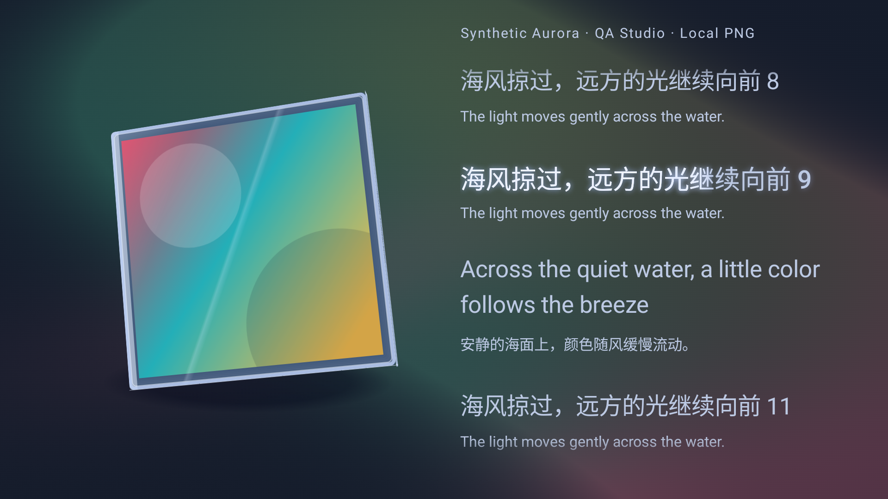
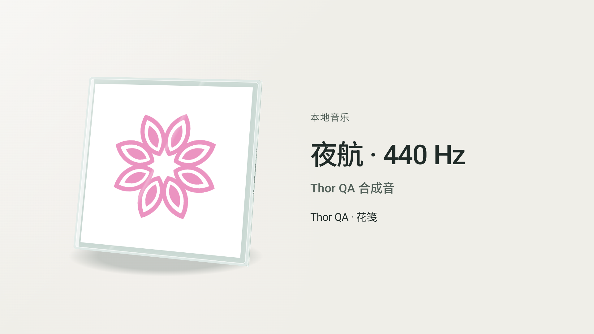
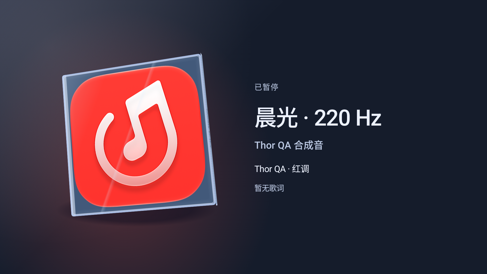
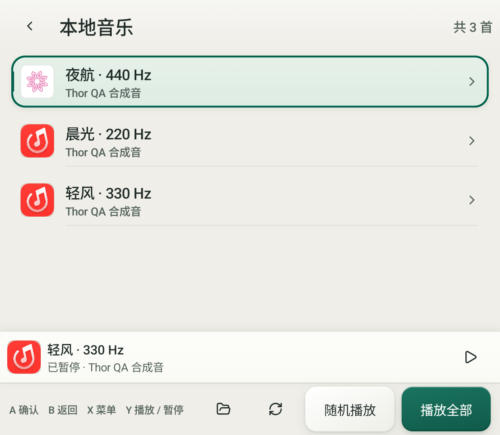
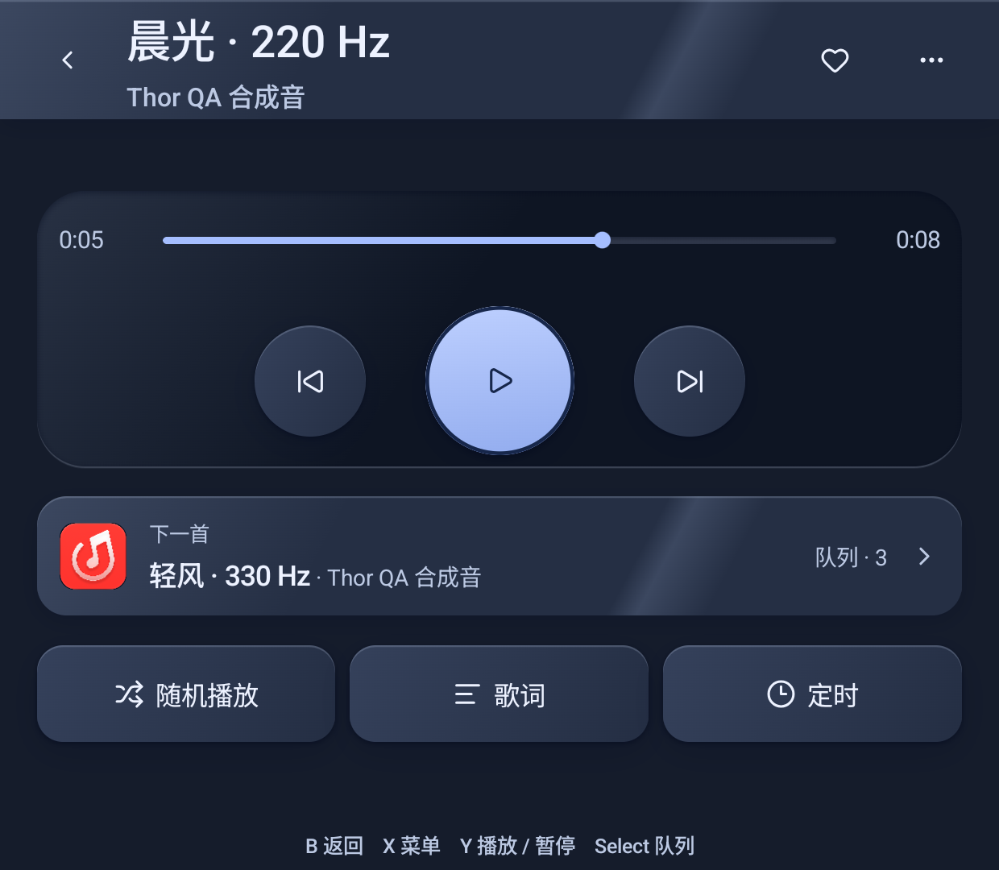
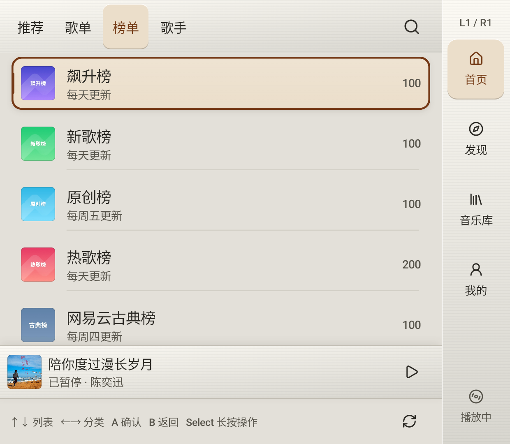
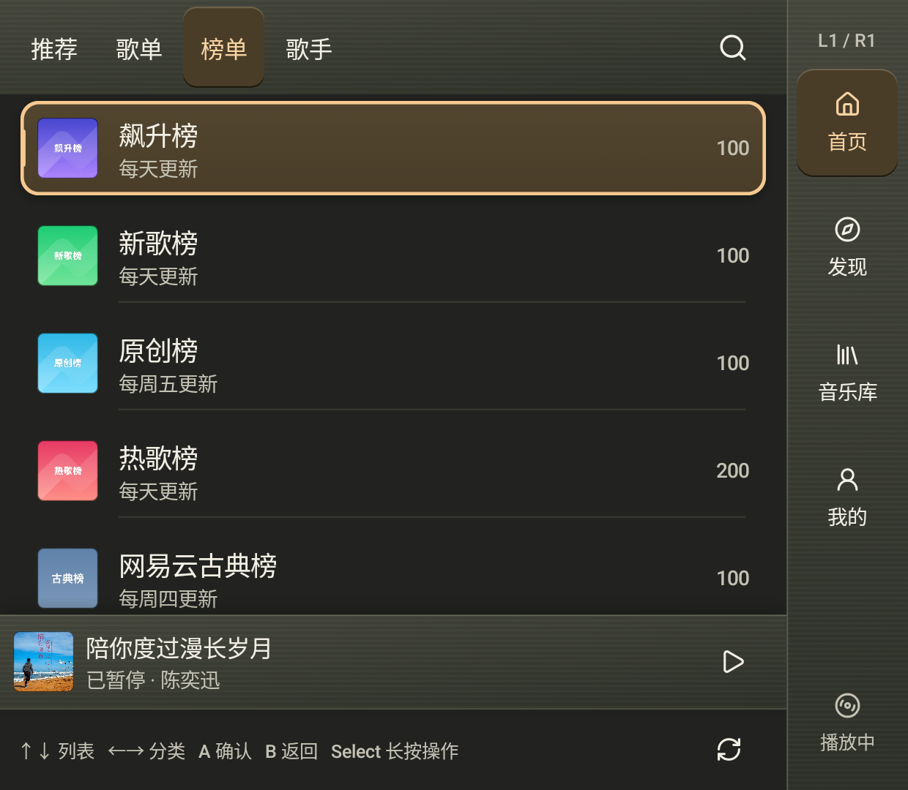

<div align="center">

# MeiloX-Thor


### 为 AYN Thor 双屏掌机适配的音乐客户端


下屏选歌与控制，上屏展示 3D CD 封套、封面流光和歌词。

</div>

## Fork 来源

本仓库 [TobiasYin/MeiloX-Thor](https://github.com/TobiasYin/MeiloX-Thor) **直接 Fork 自 [NEORUAA/MeiloX](https://github.com/NEORUAA/MeiloX)**，在其账号、音乐服务、数据库和播放队列基础上，增加 AYN Thor 双屏布局与原生手柄交互。

项目演进关系：

**[Mei](https://github.com/ljyh223/Mei) → [MeiloX](https://github.com/NEORUAA/MeiloX) → MeiloX-Thor**

MeiloX 的上游 Android 基础来自 Mei，产品与部分界面参考 [MeloX](https://github.com/youshen2/MeloX)。感谢原作者和所有贡献者。本 Fork 保留上游版权、署名和第三方声明，主体代码继续遵循 **GNU GPL v3**，详见下方[许可证与第三方声明](#许可证与第三方声明)。

> 开发中的非官方客户端，项目本身不提供音乐资源。音乐内容、账号权限与服务可用性由网易云音乐及相关权利人决定。

## 使用效果

以下均为 **Android 原生运行截图**，不是浏览器设计稿。展示曲目使用 QA 本地测试音源或测试生成的封面／歌词，不包含登录凭据。

### 封面流光与沉浸式歌词

夜间播放上屏：从封面提取多组颜色，形成柔焦流光；左侧 3D 封套轻柔浮动，右侧歌词呈现渐变柔光。下图为本轮实体 Thor 原生运行截图，使用测试生成的封面和歌词；静态截图无法完整表现动态效果。

<p align="center">
  
</p>

### 双屏浏览与播放

上屏 1920 × 1080、下屏 1240 × 1080。下图使用统一像素缩放比例，保留各自宽高比；展示比例不代表掌机的实体尺寸。两列来自不同原生验证场景，夜间配对截图早于上面的流光增强。

<table>
  <tr>
    <th>陶瓷 · 日间浏览</th>
    <th>晶雾 · 夜间播放</th>
  </tr>
  <tr>
    <td align="center"></td>
    <td align="center"></td>
  </tr>
  <tr>
    <td align="center"></td>
    <td align="center"></td>
  </tr>
</table>

更多主题、双屏截图与历史验证见 [Thor 文档](docs/thor/README.md)。上游手机界面截图仍保留于 [screenshot](screenshot/)，不作为 Thor 双屏适配效果。

### 首页分类与榜单

实体 Thor 下屏，保留 1240 × 1080 的原始比例；顶部分类和右侧一级页独立，手柄光标停留在内容列表。

<table>
  <tr><th>白天</th><th>夜间</th></tr>
  <tr>
    <td></td>
    <td></td>
  </tr>
</table>

## Thor 适配内容

- **双屏分工**：下屏浏览列表、操作菜单和播放控制；上屏展示封面、专辑资料及歌词。首页、发现、音乐库、我的四个一级页使用右侧侧栏，详情与播放器采用沉浸式布局。
- **首页找歌**：顶部推荐、歌单、榜单、歌手四分类；首页歌单展示推荐，发现负责语种／风格／场景分类与真实游标续页。每日推荐、官方排行榜、歌手地区／类型、热门歌曲／歌曲／专辑分页及歌手搜索，继续使用同一双屏 Activity 与现有登录态。搜索支持综合／歌曲／歌手／专辑／歌单，点歌手进入作品列表。
- **原生手柄操作**：方向键／摇杆仅在当前列表或明确的选项范围内移动；Tab、播放页、队列与页面动作使用独立快捷键。上屏不进入手柄焦点链。
- **3D CD 封套**：双面贴图、透视与材质高光；触摸拖动、惯性和近正面归位。音乐播放时上下呼吸浮动并轻微偏转；拖动优先接管。
- **主题与背景**：微砂陶瓷、晶雾、钛金三套材质，浏览与播放均支持白天／夜间／跟随系统。播放背景可选封面流光、柔焦渐层或纯净，并可调整强度；支持减少动态与减少透明。
- **歌词交互**：逐字时间驱动的渐变柔光、双语歌词、稳定自动跟随、上下渐隐；拖动仅浏览，停止操作 15 秒后恢复跟随，点击某行可从该处播放。只有逐行时间的歌词使用行内渐变进度。
- **音乐管理**：喜欢歌曲、收藏专辑／歌单、加入播放列表、下一首播放、临时队列与分级菜单。选歌后进入播放器，返回时保留原列表选中项和滚动位置。
- **账号与设置**：复用上游登录态及业务；登录、账号绑定、音频设置与十段均衡器嵌入 Thor Activity，减少跨 Activity 对双屏的干扰。
- **播放权限与恢复**：明确受限歌曲在列表显示“不可播放”，批量播放提前过滤；运行时通过有界候选检查寻找下一首，避免快速逐曲连跳。缺少权限字段或只有 VIP／付费标签不会直接被判为禁播。
- **本地与在线音乐**：保留网易云搜索、音乐库、播放历史、随机／循环、定时停止和本地音乐能力；歌词共享继续复用 Lyricon、SuperLyricApi 与 ColorOS Bridge。

吹气为可选交互，需要麦克风权限。**音乐播放时停止吹气采集与输入**，避免扬声器触发封套旋转；暂停后按用户开关恢复。实体麦克风的强度、孔位与固件差异仍需按设备验证，不能用模拟信号测试代替真机结论。

## 设备与验证状态

| 设备档 | 上屏画布 | 下屏画布 | 当前范围 |
|---|---|---|---|
| **AYN Thor** | 1920 × 1080，16:9 | 1240 × 1080，31:27 | 主适配目标；2026-11-01 已完成真实会话、在线播放、云管理及原生真机回归 |
| Retroid Pocket Duo / RP Duo | 1920 × 1080，16:9 | 1280 × 960，4:3 | 已有设备档与模拟器布局验证，尚未完成真机兼容／性能验收 |

应用最低 Android 13，当前构建仅包含 `arm64-v8a`。其他非常规屏幕组合不在当前适配范围。

最新视觉更新：歌词使用珍珠白／深银墨和细窄柔光，背景保留封面取色并增加缓慢流体形变。**1,332 项 JVM 测试通过，应用／测试 APK 构建成功**；提供有明确范围标记的离线渲染对照，原生验收因真机离线待执行。见[珠光与流动记录](docs/thor/elegant-light-validation.md)。

前一轮播放更新：播放页可触摸或长 Select 选择音质，显示全局默认与当前实际音质。目标档位不可用时使用本曲最高可用完整音源，保留默认并在下一首重新尝试。**1,321 项 JVM 测试通过，应用／测试 APK 构建成功；指定真机离线，新增原生验收待执行**。见[播放音质记录](docs/thor/quality-selection-validation.md)。

前一轮修复：歌手作品页检查完整音源，提前标记当前会话明确仅可试听的歌曲；首页推荐歌单与发现分类歌单分工独立。**1,315 项完整应用 JVM 测试通过、零跳过，应用与测试 APK 构建成功；修复后的真机验收因设备离线待完成**，根因、范围与当前状态见[歌手音源与首页／发现记录](docs/thor/artist-source-discovery-validation.md)。

上一轮搜索更新：**1,291 项完整应用 JVM 测试通过，相关 8 项原生方法在实体 AYN Thor 上通过，零跳过**。综合结果交错展示类型、精确歌手前置、五类筛选、歌手作品与单曲播放返回见[搜索歌手验证](docs/thor/search-artists-validation.md)。[首页发现](docs/thor/home-discovery-validation.md)的 15 项和[流光与取色](docs/thor/lyric-flow-atmosphere-validation.md)的 33 项验证分别保留，不与本轮相加。

前一轮综合功能源码基线 `6b59b9e0` 的 **91 个不同原生真机方法**记录单独保留，其中 74 项为生产组件回归、17 项为真实会话与播放等集成；两轮数量不相加。该轮已修复搜索 405 和云歌单加入顺序，并回读确认测试歌单清理。详细范围见[综合真机验收](docs/thor/live-acceptance-validation.md)；历史模拟器结果保留在[权限与恢复验证](docs/thor/availability-recovery-validation.md)。

## 手柄速查

| 按键 | 操作 |
|---|---|
| 方向键／左摇杆 | 在当前列表或选项区域内移动 |
| ← / → | 首页切推荐／歌单／榜单／歌手；歌手详情切热门／全部歌曲／专辑；非编辑搜索页切类型，光标不进入分类标题 |
| A / B | 确认／逐层返回；首页 2 秒内再次独立按 B 才退出 |
| X / 触摸长按 | 打开当前条目菜单，支持上下选择与左右进出子菜单 |
| L1 / R1 | 一级页切 Tab；播放页短按后退／前进 15 秒，按住预览进度、松开应用 |
| L2 / R2 | 上一首／下一首；线性扳机必须归零后才算下一次 |
| Y | 播放／暂停 |
| Start | 全局进入播放页，再按返回原页面 |
| Select 短按 | 打开／关闭队列 |
| Select 按住 | 打开页面操作，如搜索、刷新、播放全部、随机播放等 |
| L3 / R3 | 有批量播放动作的列表页：L3 随机播放，R3 播放全部 |

菜单和输入框会接管当前输入；搜索编辑时 A 提交、B 先结束编辑。完整规则见[手柄与焦点文档](docs/thor/controller-validation.md)。

## 从源码构建

当前 Thor 适配位于 **`feat/thor-dual-screen-player`** 分支。使用 JDK 21、Android SDK 37.0、NDK 27.1.12297006 和 CMake 3.22.1；Gradle Wrapper 随仓库提供。先配置 `JAVA_HOME` 与 `ANDROID_HOME`，并将 Android SDK Command-line Tools 加入 `PATH`。

```sh
git clone --branch feat/thor-dual-screen-player --single-branch https://github.com/TobiasYin/MeiloX-Thor.git
cd MeiloX-Thor

# Glasmio 源码放在项目的同级目录，使用与 CI 相同的固定版本。
git clone https://github.com/NEORUAA/Glasmio.git ../Glasmio
git -C ../Glasmio checkout bbba63b2f2584c4819bd88043332e241820d1ca0

# 使用 Android SDK Command-line Tools 安装构建依赖。
sdkmanager "platforms;android-37.0" "build-tools;37.0.0" "ndk;27.1.12297006" "cmake;3.22.1"

./gradlew -Pglasmio.source=true :app:assembleDebug
```

Debug APK：`app/build/outputs/apk/debug/app-debug.apk`。项目保留上游的应用 ID `com.neoruaa.meilox`。

```sh
# 完整 JVM 测试
./gradlew -Pglasmio.source=true :app:testDebugUnitTest

# 构建设备测试包；运行时需选择具有上下两块显示的模拟器。
./gradlew -Pglasmio.source=true :app:assembleDebugAndroidTest

# 开发调试安装
adb install -r app/build/outputs/apk/debug/app-debug.apk
adb shell am start -n com.neoruaa.meilox/com.ljyh.mei.thor.ThorActivity
```

主 Activity 在主屏运行，下屏由 Presentation 管理；不用在两块屏幕上分别启动 Activity。双屏模拟器需自行配置，本仓库不包含开发机上的 AVD。Glasmio 的集成说明见 [docs/glasmio-integration.md](docs/glasmio-integration.md)。

## 文档与反馈

- [Thor 文档入口](docs/thor/README.md)：功能、设备档、截图、设计与验证索引。
- [最新权限／恢复验证](docs/thor/availability-recovery-validation.md)：列表禁播、有界候选、完整回归记录。
- [列表、搜索与焦点](docs/thor/interaction-refinement-validation.md)：列表返回、搜索按钮、提示计时与上屏展示边界。
- [账号与音频设置](docs/thor/embedded-settings-validation.md)：登录、绑定、设置内嵌与回归范围。
- [主题系统](docs/thor/theme-system.md)：三材质、日夜、环境层与动效契约。

反馈时请注明源码提交、设备型号／系统、上下屏配置及复现步骤，并隐藏账号、Cookie、验证码等个人信息。针对 Thor 适配的改动请提交到[本 Fork](https://github.com/TobiasYin/MeiloX-Thor/pulls)，避免与上游手机界面的反馈混淆。

## 开源致谢

保留并感谢上游使用或参考的项目：

- [Mei](https://github.com/ljyh223/Mei)：上游 Android 项目与基础能力。
- [MeiloX](https://github.com/NEORUAA/MeiloX)：本 Fork 的直接来源，网易云业务、播放器与界面基础。
- [MeloX](https://github.com/youshen2/MeloX)：产品与参考实现。
- [Glasmio](https://github.com/NEORUAA/Glasmio)：界面组件与液态玻璃渲染；保留 [AndroidLiquidGlass / Backdrop](https://github.com/Kyant0/AndroidLiquidGlass) 来源。
- [amll-ttml-db](https://github.com/Steve-xmh/amll-ttml-db)、[accompanist-lyrics-ui](https://github.com/6xingyv/accompanist-lyrics-ui)：歌词数据、模型与渲染。
- [Lyricon](https://github.com/tomakino/lyricon)、[SuperLyricApi](https://github.com/HChenX/SuperLyricApi)、[ColorOS Live Lyrics Bridge](https://github.com/Andrea-lyz/ColorOS-Live-Lyrics-Bridge)：歌词共享。
- [Lucide](https://github.com/lucide-icons/lucide)：Thor 图标，保留 ISC 及 Feather 衍生图标的 MIT 声明。

其余模型、运行时、脚本、字体和素材的来源见 [THIRD_PARTY_NOTICES](THIRD_PARTY_NOTICES)。

## 许可证与第三方声明

**MeiloX-Thor 主体代码沿用上游 [GNU General Public License v3](LICENSE)**，保留原作者版权与署名；本 Fork 的 Thor 适配继续按同一主体许可证发布。

Mei 的上游代码、Glasmio 和 AndroidLiquidGlass／Backdrop 保留其 Apache-2.0 声明，MeloX 参考代码保留其 GPLv3 条款。第三方组件、模型、字体和素材继续遵循各自的原始许可证与分发条件，本 Fork 不扩大或替代它们的授权。

完整声明见 [THIRD_PARTY_NOTICES](THIRD_PARTY_NOTICES)；Thor 图标的完整许可见 [lucide.LICENSE](app/src/main/assets/licenses/lucide.LICENSE)。上游声明中列出的 NetEase 专有运行时、SF Pro、PV Tool 衍生内容及模型等有独立条件，公开分发二进制前须按该声明逐项处理。项目不提供音乐资源，也不授予任何音乐内容、封面或第三方品牌的使用权。

<div align="center">

MeiloX-Thor · Fork of MeiloX · Made with Jetpack Compose

</div>
