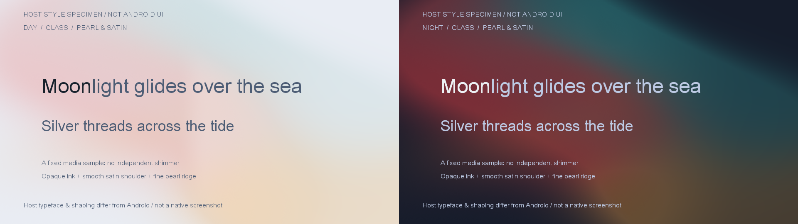

# 歌词珠光与流动背景

本轮保留用户认可的封面取色、颜色权重和背景明暗，只细化歌词光泽与背景运动。代码已构建，完整 JVM 与离线真实 SkSL 验证通过；指定真机仍离线，不能将本轮标为原生设备已验收。

## 设计取向与歌词

依据 UI/UX Pro Max 的 Music Streaming 浅色前景、Soft UI Evolution 柔光深度／明确对比，以及克制运动与减少动态准则，采用“珍珠白／银墨 + 缎面反光”。Skill 没有直接提供珠光歌词配方，具体色值为本项目按上述准则设计并验证的语义值。

| 模式 | 唱入正文 | 窄亮脊 | 反射 |
| --- | --- | --- | --- |
| 夜间 | `#EEF1F4` 珍珠白 | `#F8FAFC` 冷白 | 低饱和暖银／冷银，按三种材质微调 |
| 白天 | `#17212B` 深石墨 | `#43505C` 深银墨 | 深暖灰／深冷灰；不把歌词照白 |

新 `theme.lyricSheen` 集中管理正文、反射、亮脊、外缘与宽度。它独立于交互 accent 和封面色，跟随已动画化的正文亮度切换日夜，避免瞬间闪白。三材质和两模式共享布局。

逐字前沿采用宽柔反射与约 2dp 的细脊，透明度及其斜率在边缘平滑归零；夜间仅留极轻的字形轮廓，白天无外缘光晕。移除旧 accent 染色、blur shadow 与横向矩形裁边。效果仍直接使用实际媒体时间，暂停后没有自行循环的 shimmer；字形和双向文字在缓存阶段处理，不逐帧重新排版。减少动态保留实心唱入进度，减少透明立即关闭光泽。翻译、行高、浏览、15 秒回跟随与点行播放保持原逻辑。

以下是使用相同 tokens、反射包络与固定媒体时刻生成的日夜色样；字体与 shaping 来自 Host，因此**不是 Android／真机截图**：

## 背景流动

保留 `forAmbient` 映射、`ThorBackdropProfile` 的原色强度、三池色权重、底色、几何和阅读区颜色保留率。新增嵌套低频流场，推动原色池产生缓慢形变；宽软光脊与错位软影全部使用原封面三色，让颜色产生空间上的流动与体积。

维持半分辨率保留层、单次 shader、30 Hz 绘制目标，未添加逐帧 CPU 模糊、粒子或闪烁。暂停缓停、隐藏／减少动态停帧、柔焦渐层／纯净静态模式及阅读区最终对比保护保持。减少透明时不画新增光泽。所有新时间频率保持长周期连续，避免久播跳变。

离线真实 SkSL 还发现并修正 Gaussian 单侧硬边：负距离的 `pow(d, 2.0)` 改为明确的 `d*d`。宽度、权重、色值保持，光带两侧恢复对称。[最小运行证据](elegant-light-evidence/gaussian-domain-proof.json)。

[白天流动视频](elegant-light-evidence/day-after-host-10fps.mp4)、[夜间流动视频](elegant-light-evidence/night-after-host-10fps.mp4)及[白天对照](elegant-light-evidence/day-before-after-filmstrip.png)、[夜间对照](elegant-light-evidence/night-before-after-filmstrip.png)来自 **CanvasKit CPU 直接执行真实 SkSL**。统一使用既有合成三色、Glass／Medium、960×540，相位严格为 `0.20 × 秒`。视频 10 fps 只是离线导出采样率，不代表 Android 性能；没有合成假 App 界面。

## 验证与边界

完整应用 JVM **1,332 项通过，失败、错误、跳过均为 0**，本轮新增 11 项。配色逐一检查三材质日夜的所有不透明正文／反射／亮脊，在主题各承载面与实际 shader 可读边界均达到 **4.6:1**；并验证强调色独立、主题过渡、减少透明、反射边缘及运动连续性。应用／测试 APK 构建成功。

离线 before 与 after shader 均实际编译成功，诊断为空，反射保持 13 uniforms／35 float slots；前后输入色值与参数逐项相同。三时刻采样中，阅读区相对 Glass 次级文字的最差对比为日间 **4.7656**、夜间 **4.7446**。变化量用于确认流动更明显，不作为美观或性能通过标准。[编译记录](elegant-light-evidence/host-report.json)、[像素记录](elegant-light-evidence/pixel-report.json)、[文字样张范围](elegant-light-evidence/lyric-sheen-host-specimen.json)。

本轮增加 2 个字形／双向文字／减少透明原生测试和 1 个背景连续多帧原生测试，已随现有测试 APK 编译，**尚未在物理设备执行**。实际 Android 字形、GPU shader、帧耗时和持续运行仍需在 `192.168.31.183:41323` 恢复连接后验收，未使用模拟器替代。此前真机轮次不能代替这次结果。[本轮摘要](elegant-light-evidence/results.json)。

功能源码为 `3c1e65c8`。[构建及安装状态](elegant-light-evidence/build.json)。
