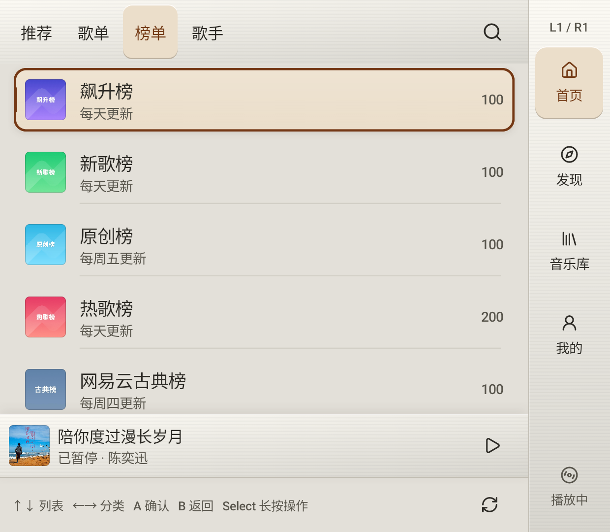
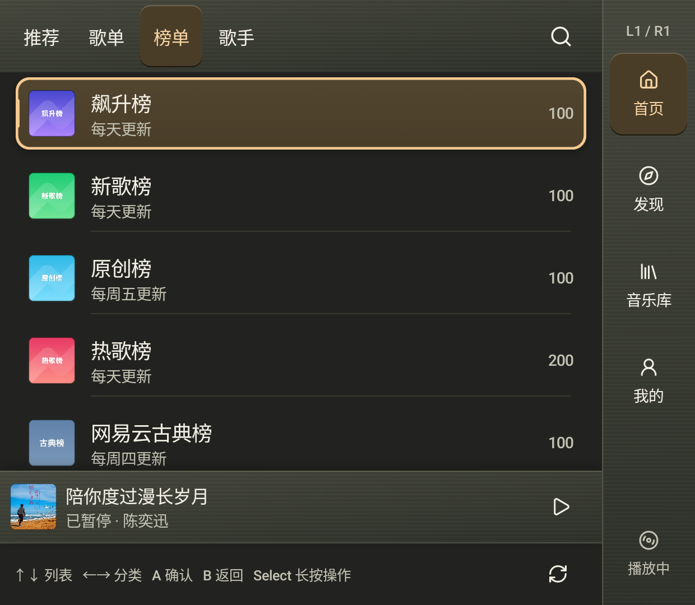

# 首页分类、榜单与歌手：实体 Thor 验证

本轮补齐首页找歌入口，将推荐、歌单、榜单、歌手组织为下屏顶部四个分类。推荐首项进入每日推荐；歌手目录支持地区与类型，详情提供热门、全部歌曲和专辑。仍使用同一 ThorActivity 与下屏 Presentation，账号、收藏、歌单详情、播放服务和队列继续沿用现有实现。

## 功能与操作

| 页面 | 实际能力 | 手柄与返回 |
|---|---|---|
| 推荐 | 现有首页推荐资源，新增每日推荐歌曲入口 | 上下选内容、A 进入；每日歌曲可逐曲播放、L3 随机、R3 播放全部 |
| 歌单 | 分类、封面和简介、真实时间戳游标分页 | 长 Select 或触摸选择分类；末尾 A 加载更多，光标交给第一条新增内容 |
| 榜单 | 服务端官方榜单目录、更新频率、歌单详情和歌曲 | A 进入榜单；继续使用权限过滤、歌曲菜单、随机和播放全部 |
| 歌手 | 热门目录、华语／欧美／日本／韩国等地区与男／女／组合筛选 | A 进入歌手，B 返回目录并恢复原选中 key 和滚动 |
| 歌手详情 | 热门歌曲、全部歌曲 offset 分页、专辑分页、原有专辑详情 | 左右切三个分类；歌曲 A 播放，专辑 A 进入详情；B 逐层返回 |
| 搜索 | 在歌曲、专辑、歌单以外补入真实歌手结果 | 歌手结果直接进入同一歌手详情与作品列表 |

首页和歌手详情的左右输入是明确的分类快捷操作，光标不进入顶部分类、搜索、右侧一级页或页脚。L1/R1 仍切换四个一级页，Start 仍全局展开／收起播放器。筛选器在下屏原地显示封闭列表，上下/A 选择、B 返回，左右不逃出筛选区；也能从长 Select 页面操作进入。

目录与每个歌手分类使用独立场景记忆。新列表从首项开始；打开专辑、播放器后返回恢复原位置。分页保留旧数据和顺序，读取失败可在尾行重试，加载中重复 A 不产生重复请求。尚有后续页的歌手作品标为 `40+首／张`，批量按钮明确为“播放已加载／随机已加载”；完整后恢复“播放全部／随机播放”，不把已载的一页称作整个歌手作品。

## 数据与复用

首页推荐复用 `HomeRepository`，每日歌曲与作品沿用现有曲目结构、权限映射和播放桥。新增 `ThorCatalogRepository` 使用项目已有 `MeloXEapi`／`MeloXWeapi` 签名服务，补齐真实目录请求；没有修改 Cookie、OS 身份、登录协议或播放后端。榜单直接读取官方目录，不用精品歌单的“榜单”标签充当官方排行。

歌单保留 64 位 `lasttime` 游标，拒绝不推进的游标；歌手和作品按服务端原始条数推进 offset，客户端去重不改变下一个偏移。筛选只清理受影响目录；刷新保留可见数据。请求带接收时的账号票据，发送前检查 session，返回后检查账号、generation、筛选和 revision。换账号丢弃旧目录与歌手缓存，不影响设备本地音乐。

每日推荐未登录时显示登录入口并且不发送推荐请求。原版和服务端推荐中继续只消费当前可识别的音乐资源；本轮四分类与每日推荐不代表原版所有非音乐功能均已迁移。

## 本轮验证

完整应用 JVM 套件 **1,276 项通过，失败、错误、跳过均为 0**，本轮增加 35 项，包含分页、权限映射、真实签名传输、业务码拒绝、账号与刷新迟到响应、目录导航、当前分类播放和歌手菜单安全。

实体设备为 AYN Thor，ADB 目标 `192.168.31.183:41323`，Android 13；上屏 1920 × 1080，下屏 1240 × 1080。本轮相关 **15 个不同原生方法通过、零跳过**：

- 真实已登录会话与实际上下屏窗口集成 2 项：完整找歌／播放／返回流程，以及歌手地区、类型、目录分页和搜索。
- 新生产分类标题、筛选列表和分页状态的组件回归 4 项，覆盖 Thor 与 Duo 内容宽度；Duo 仅布局回归，不宣称真机验收。
- 原有封闭焦点、未实现行确认、首项和返回滚动回归 9 项。

真实服务最终一轮读取到 80 条首页推荐、40 条歌单并追加 40 条、65 个榜单及 100 首榜单详情歌曲；读取了 40 位热门歌手、50 首热门歌曲、40＋40 首歌手歌曲、40 张专辑，以及 33 首每日歌曲。另实读华语男歌手 40 位并追加 40 位，并从搜索回读同一歌手身份。数字是本次会话的服务端结果，不是固定内容或未来条数承诺。

完整流程经实际 Activity 的手柄键事件路由验证：列表末尾 A 加载后进入第一条新内容；歌手→专辑→B→目录恢复原选中；左右切分类且标题不获焦；L1/R1 保持一级页语义；每日曲目先取得本账号真实完整 HTTP 音源，再经列表 A 播放并确认 Media3 进度增加，B 返回原曲目位置。测试后恢复原队列、筛选和主题偏好，未创建或修改云歌单。

另外收紧分页的在途判断：结果和新游标发布后即可接受下一次加载，不再因为旧协程刚发布完但尚未退出而忽略合法点击。筛选集成验证比较真实接口返回的稳定身份，不依赖可能被 StateFlow 合并的短暂 loading 事件。

日夜验证读取实际下屏 Window 的 PixelCopy，确认真实像素不同，均为 1240 × 1080。推荐、目录与筛选请求未用 fixture 数据伪装；本轮没有重做人工吹气验收。

功能源码提交为 `353a8998`。提交后仅更新构建身份，重新构建并保留数据安装应用／测试 APK，设备上的 SHA-256 与本地文件一致；最终安装包另行通过真实会话 profile 检查。此安装后检查不计入上述 15 个相关方法。

| 白天 | 夜间 |
|---|---|
|  |  |

## 证据

- [逐方法与 JVM 汇总](home-discovery-evidence/results.json)
- [真实目录与播放返回摘要](home-discovery-evidence/live.json)
- [真实筛选与搜索摘要](home-discovery-evidence/filters-live.json)
- [功能源码和安装包校验](home-discovery-evidence/build.json)

公开摘要只保留状态、条数和验证结论，不包含账号 ID、凭据、请求体或私人歌单。该 15 项为本轮相关验证，不与前轮逐字流光 33 项或综合功能 91 项相加。
