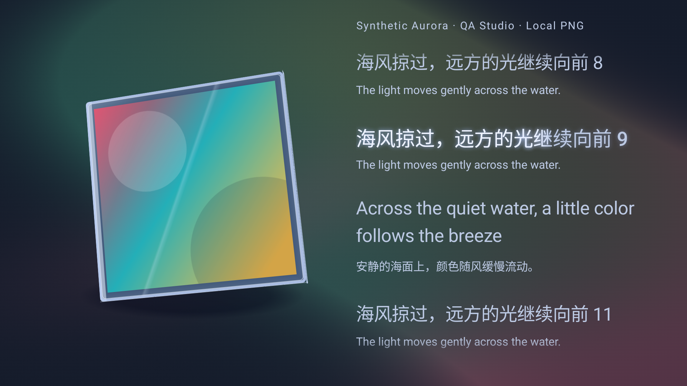

# 逐字歌词流光与封面取色：实体 Thor 验证

本轮针对“逐字歌词缺少流光、播放背景仍像纯色”的反馈更新实际 Android 播放链路。验证使用实体 AYN Thor，ADB 目标 `192.168.31.183:41323`，Android 13；上屏 1920 × 1080，下屏 1240 × 1080。没有使用模拟器结果替代真机结果。

## 实现与问题原因

歌词当前行按服务返回的逐字时间段推进，已唱部分保留清晰文字，前沿叠加窄幅渐变和柔光。绘制直接采样现有 Media3 播放器时间，不以 250ms 的业务状态刷新间隔推动流光；换行也跟随绘制时钟。时间变化只更新绘制和实际发生变化的当前行，不逐帧重建字符串或测量文本，双语、注音和行高仍按原布局保留。

同时修正自动歌词源选择：网易云 YRC 已包含有效逐字时间时，即使没有翻译，也保留 YRC；用户明确选择 LRC 时仍尊重该设置。只有逐行时间的 LRC 使用连续的行内进度渐变，不将其标为真实逐字时间。暂停后效果保持当前进度，隐藏或启用“减少动态”时停止装饰帧；减少动态仍保留静态进度着色。

背景原链路已经取得真实封面，但日间取色过度混入白色，且歌词区只保留约 6.5%／10% 的封面颜色，左侧色团又容易被封套覆盖，导致整屏接近纯色。本轮保留封面的冷暖与饱和度，扩大三组柔焦色场，覆盖右侧和底部；以低速形变和柔光带形成可见流动。实际封面由已有 Coil 加载，同一 Bitmap 提供封套纹理和颜色，不另外伪造在线封面。

背景继续使用主题 Token 和既有模式／强度设置。三套材质均支持白天与夜间；纯净模式保留纯净，柔焦渐层保持静态，减少动态保留取色但停止流动，减少透明改为哑光色场。着色器对实际文字和次级文字做亮度约束，保护歌词可读性；实际 API 33 AGSL 路径在真机执行，未以着色器失败后的回退视图算通过。

## 验证范围

- 完整应用 JVM 套件：**1,241 项通过，失败、错误、跳过均为 0**，含 YRC 缺少翻译、真实逐字时间、Unicode 边界、播放位置跳转、取色和对比度回归。
- 本轮相关实体设备方法：**33 项通过，零跳过**。其中新增歌词流光 4 项、背景 4 项、真实在线视觉集成 1 项；原有歌词交互 12 项、封套播放动效 5 项、上屏焦点隔离 4 项、主题动态 1 项、真实在线歌词触摸与 seek 1 项、实际窗口帧耗时 1 项。
- 新增实时换行回归使用不属于 Compose 状态的 `AtomicLong` 模拟实际播放器时钟，确认不依赖业务 Bridge 事件也能及时激活下一行。原有稳定行高、顶部／底部渐隐、手动浏览、15 秒自动跟随和点击行播放均通过。
- 真实在线集成使用已登录的现有会话与真实音源，确认实际 Media3 播放进度增加、封面加载和歌词返回。通过实际 ThorActivity 上屏 Window 的 PixelCopy 采样白天／夜间完整 1920 × 1080 图像；没有用测试组件截图代替在线链路。

真实歌曲本轮返回 **41 行、391 个逐字时间段**，歌词来源为 QQMusic。临时切换白天／夜间、中等强度封面流光后，各取相隔 2.8 秒的两帧，在封套与歌词以外的 19 个固定背景点比较，两个主题都测到背景变化。原设置本身已经是封面流光／中等强度，减少动态和减少透明均未开启；问题来自原颜色权重过弱。测试结束恢复原偏好和完整播放队列，未修改云歌单。

本轮 33 项是针对此次视觉改动的相关回归，不与[上一轮综合真机验收的 91 项](live-acceptance-validation.md)相加，也不宣称重复执行了那一轮的全部服务器与权限场景。吹气已由用户确认正常，本轮没有再要求人工吹气验收。

功能提交 `d87367a8` 完成后重新构建应用和测试 APK，保留数据安装至同一实体机；安装包 SHA-256 与设备上的实际 APK 一致。仅提交身份信息变化，没有后续生产代码改动；最终包另行通过真实会话 profile 检查，确认继承的登录态仍有效。这项安装后检查不计入上述 33 个视觉相关方法。

## 证据与边界

- [逐方法结果及 JVM 汇总](lyric-flow-atmosphere-evidence/results.json)
- [真实在线日夜图像采样摘要](lyric-flow-atmosphere-evidence/live.json)
- [实际完整上屏窗口帧耗时](lyric-flow-atmosphere-evidence/frame-timing.json)
- [单独执行同场景的帧耗时复核](lyric-flow-atmosphere-evidence/frame-timing-isolated.json)
- [功能源码、APK 与安装校验](lyric-flow-atmosphere-evidence/build.json)

帧耗时来自实体 Thor 上包含生产背景、封套和滚动歌词的完整窗口，使用测试生成内容。连续回归后的 5 秒采样为 298 帧，GPU p95 为 2.03ms，窗口总耗时 p95 为 28.25ms，其中 command issue 等待明显较高；单独执行同场景的复核为 299 帧，GPU p95 为 2.05ms，总耗时 p95 为 15.33ms。两组均保留，不据其中较优结果宣称稳定帧率；metrics callback 没有丢失也不等于画面零掉帧。

下图为同一生产窗口在实体 Thor 的原生截图，封面和中英文字均为测试生成内容：

真实在线播放截图及原始歌词只保留在本机忽略目录 `app/build/thor-qa/effects-real/`；公开在线证据只含状态、计数、尺寸与采样差值，不发布账号、请求、歌词全文或私人歌单。
