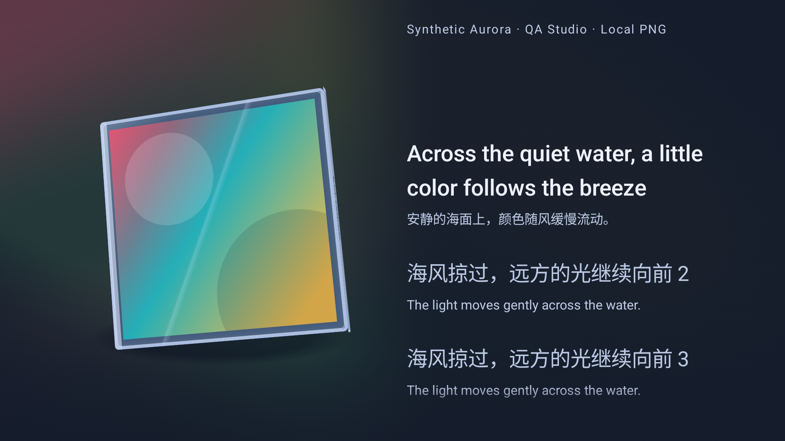

# 播放环境层实施与验证

日期：2026-10-31。代码提交：`da9e5506761ee2951baecb156cb8419e53314a89`。本次仅使用双屏专用模拟器 `thor_agent_dual_api36`，ADB `emulator-5560 / server 5038`。上屏为 display 0、1920×1080，下屏为 Presentation display 4、1240×1080，density 均为 369。未操作真机。

## 交付行为

默认播放背景改为“封面流光／中”。从现有 Coil 解码结果中提取主色、次色和点缀色，生成宽幅柔焦色场、缓慢变形的光带、边缘收光和微纹理。封面切换后平滑转色，解码期间保留上一组配色；不额外发起封面请求。透明边、极黑／极白噪点和极少量孤立色不会主导取色；缺失、失败、灰度封面有中性回退。

下屏“我的 → 主题与外观”提供“封面流光、柔焦渐层、纯净”与低／中／高强度，触摸与手柄均可操作；修改时上屏实时预览。纯净模式的强度不可聚焦，先前强度保留。设置随既有 DataStore 事务保存，不改变登录态和音频配置。

三种模式均适配陶瓷、晶雾、钛金的日／夜主题。歌词一侧逐步减弱环境色，文字仍使用主题语义色；颜色不侵入按钮、焦点环和列表。暂停缓停，隐藏与减少动态停止装饰时钟。减少透明降低色彩权重，并关闭光带高光和微纹理。

## 实际渲染截图

以下上屏截图来自原生测试的 PixelCopy，使用测试内生成的本地三色封面与合成歌词，无账号或真实用户内容。晶雾／夜间／高，封面、取色、CD 模型与歌词均走生产组件。

[同场景纯净模式](playback-atmosphere-evidence/upper-frame-timing-Clean-color-cover.png)可用于比较背景变化。独立环境层的[陶瓷日间](playback-atmosphere-evidence/background-Ceramic-Day-ArtworkFlow-high.png)与[陶瓷夜间](playback-atmosphere-evidence/background-Ceramic-Night-ArtworkFlow-high.png)截图使用固定测试配色，展示明暗处理，未叠加封面和歌词。

## 实现边界

- `ThorArtworkPalette`：最多 4096 个样本，量化与 Oklab 聚类；Bitmap 支路在后台将长边缩到 64。换图取消与身份检查避免旧请求回写。
- `ThorBackdropProfile`：集中管理模式、强度、日夜光学权重、场形、阅读区与可达性覆盖。新偏好无法识别时独立回退默认值。
- `ThorPlaybackBackdrop`：复用单个 RuntimeShader／ShaderBrush；在独立半尺寸图层绘制低频色场，再放大合成。Thor 对应逻辑绘制尺寸 960×540；没有每帧全尺寸封面模糊。驱动实际 GPU 工作量仍以测量为准。
- 相位约 30Hz 发布，状态仅在背景绘制时读取，不驱动歌词／CD 树重组；帧回调仍跟随 Choreographer，不能将发布频率等同于 GPU 帧率。双精度累计相位与完整谐波周期回绕避免原先按 2π 回绕会产生的长期跳变。Shader 创建失败时回退 Canvas 柔和径向渐层。

## 验证结果

最终 Debug APK、AndroidTest APK 与选定 JVM 回归集构建成功。507 项 JVM 测试全部通过；最终一次原生运行 24 项全部通过，耗时 121.999 秒，[原始原生日志](playback-atmosphere-evidence/native-tests.txt)可追溯。

| 覆盖项 | 结果 |
|---|---|
| 取色、透明边／噪点过滤、灰度回退、日夜亮度约束 | JVM 通过 |
| 背景偏好编解码、默认值、非法值、材质／日夜／强度／可达性配置 | JVM 通过 |
| 长期相位、2π 不提前重置、实际 Shader 谐波周期连续性 | JVM 通过 |
| 三材质 × 日夜 × 三背景，共 18 种原生渲染组合 | 实际 AGSL 绘制通过，纯净模式使用基础底色 |
| 歌词区实际背景像素与主题主／次文字对比 | 测试网格从横向 52% 开始，覆盖阅读区过渡，最低对比 ≥4.5:1 |
| 流动、暂停缓停、隐藏 20 秒、恢复、减少动态、两种静态模式 | 实际画面变化与停止绘制断言通过 |
| 模式与材质切换后的封面／歌词边界 | 保持既有排版，通过 |
| 真实下屏设置按钮、偏好保存、纯净模式焦点边界、Start／B 导航、上屏预览 | 通过，测试后恢复原偏好 |
| 既有歌词原生回归 12 项、封面交互 2 项、主题动效 1 项、视觉契约 4 项 | 全部通过 |

JVM 执行 `:app:testDebugUnitTest`，过滤 `com.ljyh.mei.thor.*`、`com.ljyh.mei.playback.*`、`*ReadableLyrics*Test`、`*LyricManualScrollStateTest` 与 `*NeteaseLoginSessionGuardTest`。原生新增测试为 `ThorPlaybackBackdropInstrumentedTest`（3 项）、`ThorBackdropFrameTimingInstrumentedTest`（1 项）与 `ThorBackgroundSettingsInstrumentedTest`（1 项）；同一轮还运行上述 19 项既有回归。

## 模拟器帧耗时

使用生产 AndroidUiDispatcher／Choreographer，ActivityScenario 无 ComposeTestRule；本地彩色 PNG 经 Coil 加载、取色，CD 浮动与实际 SyncedLyrics 同时运行，合成歌词以 1.5 倍时间推进。晶雾／夜间／高，上屏 1920×1080，预热 1.8 秒后采样约 5 秒。真实 FrameMetrics 结果如下，单位 ms。

| 模式／样本数 | GPU p50／p95 | Draw p50／p95 | Total p50／p95 |
|---|---|---|---|
| 纯净／209 | 23.26／27.59 | 0.60／1.10 | 63.16／74.19 |
| 封面流光／190 | 25.05／31.35 | 0.61／1.67 | 70.97／83.44 |

原始报告：[纯净基线](playback-atmosphere-evidence/frame-timing-Clean-emulator-only.json)、[最终流光构建](playback-atmosphere-evidence/frame-timing-ArtworkFlow-emulator-only.json)。纯净为较早一轮同场景基线，两次顺序采样不构成严格受控的性能差值。Total 是流水线耗时，不能直接换算 FPS；两个报告的 `droppedMetricsCallbacks=0` 只表示指标回调未丢失，不表示未掉帧。上述结果仅描述模拟器，不代表 Thor 真机帧率、功耗或发热；本次没有真机性能结论。

## 可安装产物

APK：`app/build/outputs/apk/debug/app-debug.apk`。最终安装已保留模拟器现有数据，并以 display 0 启动 ThorActivity；下屏由原生双屏宿主创建。安装包与已安装 base.apk 的 SHA-256 一致，完整提交号、校验和、大小和测试计数见 [构建记录](playback-atmosphere-evidence/build.json)。
