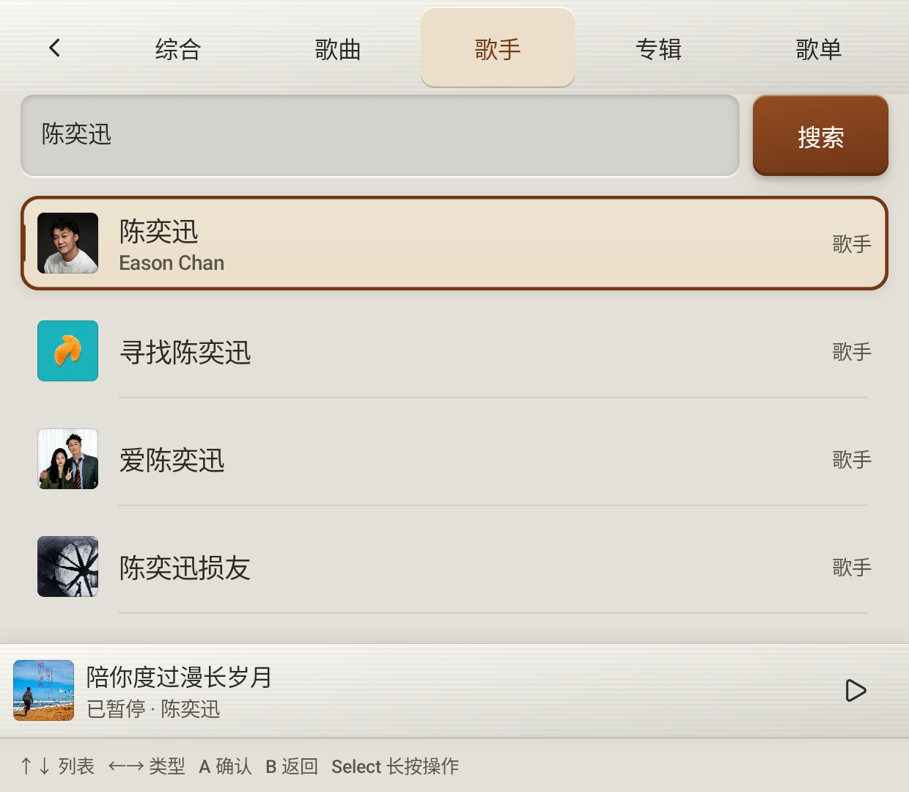

# 搜索混合结果与歌手入口：实体 Thor 验证

搜索同一关键词时，现在可以同时发现歌曲、歌手、专辑与歌单。点歌曲直接播放所选单曲；点歌手进入现有歌手作品页，查看热门歌曲、全部歌曲与专辑；点专辑或歌单仍进入相应曲目列表。

## 排列与界面

原数据接口已经请求歌手，但把整批歌曲、专辑、歌手顺次拼接，使歌手通常落在几十项之后。现在综合结果按类型交错排列，并保留每类接口内部顺序。精确姓名匹配优先于精确别名，只提前一个最佳歌手，再展示歌曲、专辑与歌单，避免其他艺人的相同别名占满首屏。类型过滤、去重和排列不改写原始 ThorItem、音乐 metadata 或播放权限。

原 56dp 标题行内放置“综合／歌曲／歌手／专辑／歌单”，没有增加第二分类行。结果行标明类型；受限歌曲继续优先显示“不可播放”。切分类只筛选本次结果，不重新请求服务器。某个接口失败时保留其他类型和本地结果，失败分类显示可重试状态，不把接口失败写成“没有找到歌手”。

## 输入与返回

- 上下只移动结果列表，非编辑时左右直接切类型，触摸与长 Select 菜单也能切换；分类标题不参与手柄焦点。
- 输入时左右仍移动文字光标。触摸或菜单切类型会先结束编辑，不自动提交草稿；搜索按钮、输入法与手柄提交继续共享可见输入。
- 每类结果拥有独立 scene；综合仍兼容原 `search:results:<entry>`。进入歌手、专辑或播放器后返回保留查询、类别、选中 key 和滚动。新查询清理旧结果记忆，同时保留用户当前选定的类型。
- 歌曲分类也明确走原 `vm.open(item)` 单曲入口，避免因为结果全为歌曲而将整批搜索结果自动放进队列。

## 验证

完整应用 JVM 套件 **1,291 项通过，失败、错误、跳过均为 0**，本轮新增 15 项：综合混排、精确姓名／别名、别名淹没、typed key 和本地／远端去重、类型与 scene、权限对象不变、导航返回，以及真实 Resource 聚合中的局部失败与空结果区分。

实体 AYN Thor，ADB 目标 `192.168.31.183:41323`，Android 13，上屏 1920 × 1080、下屏 1240 × 1080。本轮 **8 个不同原生方法通过、零跳过**：

- 搜索与歌手、单曲播放完整链路 1 项：真实艺人名搜索、综合首列可见歌曲与歌手、A 进入实际歌手歌曲列表、B 返回；切歌手／歌曲类型、保持输入类型的新查询、单曲队列仅 1 首、真实完整 HTTP 音源与 Media3 进度、B 恢复原搜索位置。
- 原有真实搜索按钮、单曲播放和实际视口恢复集成 1 项。
- 新分类标题、编辑切类和部分失败重试的原生组件 3 项，覆盖 Thor／Duo 内容宽度；Duo 仅布局，不构成真机结果。
- 原有触摸／输入法／手柄输入提交回归 2 项。
- 本账号真实权限和源数据前置核验 1 项，重新读取服务器确认测试音源与当前账号一致。

实际在线数据和返回结论见 [live.json](search-artists-evidence/live.json)，逐方法和 JVM 摘要见 [results.json](search-artists-evidence/results.json)。测试保留现有账号，完成后恢复原完整队列，没有修改云歌单；未重复人工吹气验收。本轮结果不与首页 15 项、流光 33 项或综合验收 91 项相加。

下图为真实下屏 Window 的 PixelCopy，使用实际服务返回的歌手、头像与别名；不是浏览器原型，也不是假结果注入：

功能源码为 `92fc811b`。提交后仅更新构建身份，重新构建并保留数据安装应用／测试 APK，校验设备 SHA-256 与本地一致；最终包另行通过真实会话 profile 检查，该检查不计入上述 8 项。[源码与最终安装包校验](search-artists-evidence/build.json)。公开摘要不包含账号 ID、Cookie、请求体或私人播放列表。
